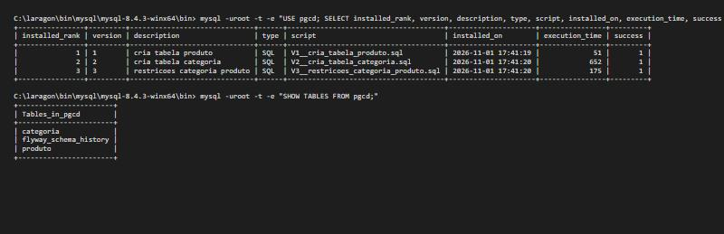

# Atividade 18 - Versionando o banco com Flyway

Prova de que as migrations aplicam do zero (Task 05):

1. `DROP DATABASE pgcd; CREATE DATABASE pgcd;` no MySQL 8.4 (Laragon)
2. Aplicacao iniciada: `MigracaoBanco.migrar()` aplicou V1, V2 e V3 em sequencia
3. Hibernate subiu com `hbm2ddl.auto=validate` sem divergencia entre entidades e schema

